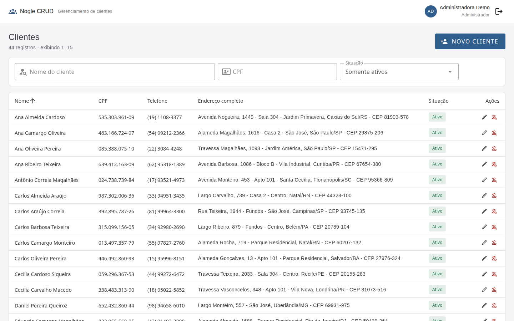
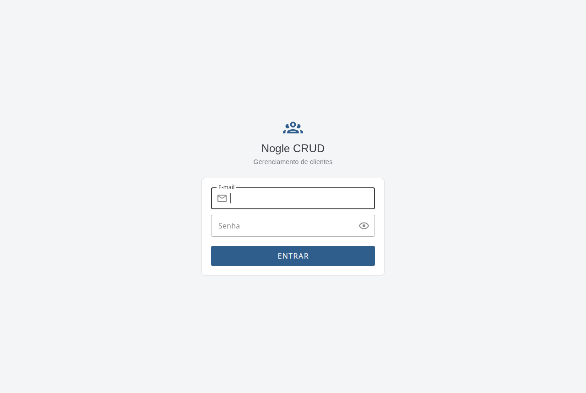
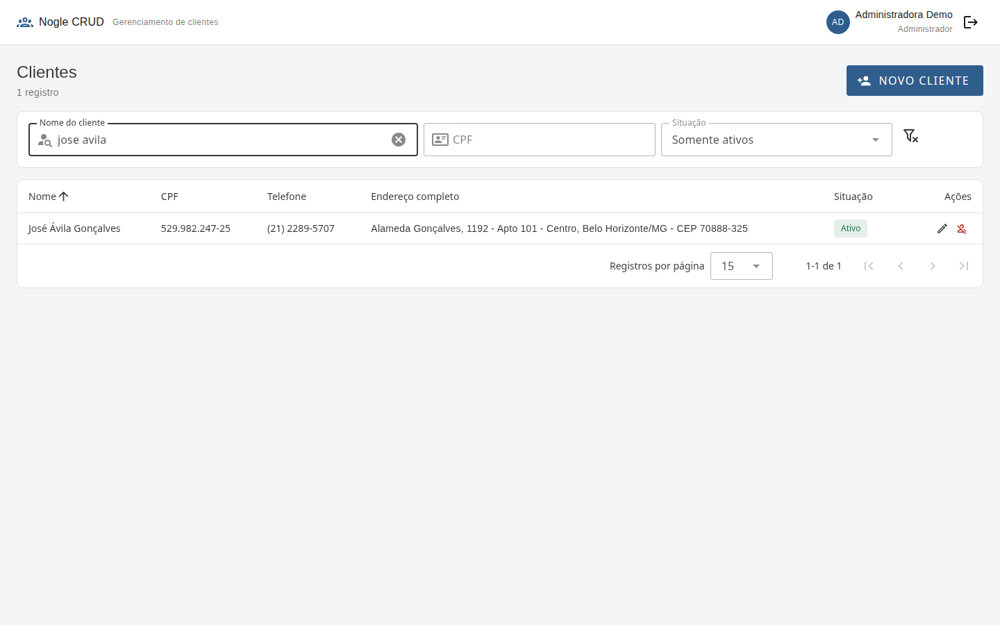
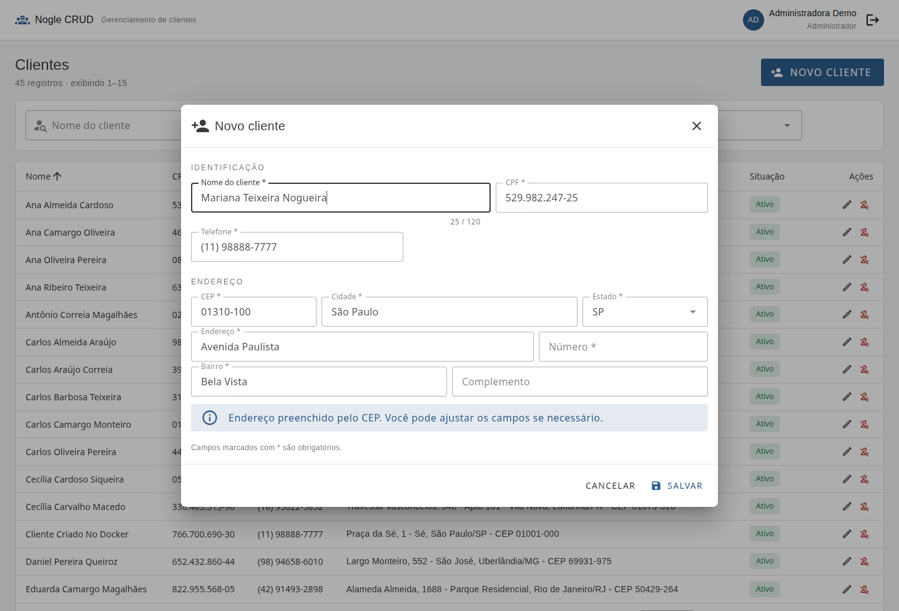
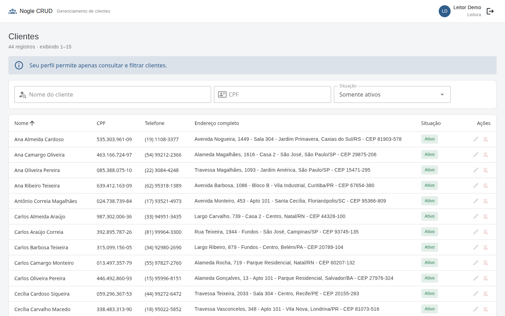
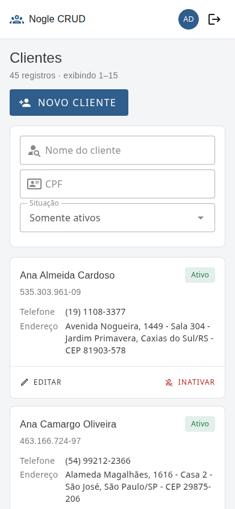

# Nogle CRUD — Gerenciamento de Clientes

Aplicação web para cadastro e gerenciamento de clientes, desenvolvida como
resposta ao desafio prático da Nogle.

Todo o gerenciamento acontece em **uma única tela**: cadastrar, editar e
inativar abrem modais sobre a mesma página, sem navegação para rotas
separadas.



---

## Sumário

- [Funcionalidades](#funcionalidades)
- [Stack](#stack)
- [Como executar](#como-executar)
- [Usuários de demonstração](#usuários-de-demonstração)
- [Testes e verificações](#testes-e-verificações)
- [Estrutura do projeto](#estrutura-do-projeto)
- [Decisões de arquitetura](#decisões-de-arquitetura)
- [Banco de dados](#banco-de-dados)
- [API](#api)
- [Capturas de tela](#capturas-de-tela)
- [Limitações conhecidas](#limitações-conhecidas)
- [Documentação complementar](#documentação-complementar)

---

## Funcionalidades

### Requisitos originais

| Requisito | Situação |
|---|---|
| Cadastro de clientes em modal, com os 10 campos solicitados | Implementado |
| Edição de clientes | Implementado |
| Inativação, sem apagar o registro | Implementado |
| Filtros por nome e CPF, individuais ou combinados | Implementado |
| Tabela com nome, CPF, telefone e endereço completo | Implementado |
| Gerenciamento em uma única tela | Implementado |
| Interface responsiva (desktop, tablet e celular) | Implementado |
| Consulta automática de CEP preenchendo cidade e estado | Implementado |
| Scripts de criação das tabelas | [`database/schema.sql`](database/schema.sql) |

### Diferenciais técnicos

- **Validação de CPF** com verificação dos dígitos, no frontend e no backend,
  rejeitando sequências como `111.111.111-11`.
- **Busca insensível a acentuação e caixa**, resolvida no banco com `unaccent`
  e índice GIN — buscar por `jose avila` encontra `José Ávila Gonçalves`.
- **Autenticação por sessão com cookie** (Sanctum em modo SPA), com proteção
  CSRF e limite de tentativas no login. Nenhum token é guardado no navegador.
- **Dois perfis de acesso** — administrador e leitura — com autorização
  verificada por Policy no backend, não apenas escondida na interface.
- **Reativação** de clientes inativos.
- **Paginação server-side**, com ordenação restrita a colunas autorizadas.
- **Limite de requisições** na API, contra extração em massa de dados
  pessoais.
- **Docker Compose** com três serviços e subida em um comando.
- **Integração contínua** no GitHub Actions: formatação, análise estática,
  testes das duas pontas, auditoria de dependências e build das imagens.

---

## Stack

| Camada | Tecnologia |
|---|---|
| Backend | PHP 8.3 · Laravel 13.36 · Eloquent · Sanctum 4.3 |
| Frontend | Vue 3.5 · Vuetify 3.13 · TypeScript 6 · Vite 8 |
| Banco | PostgreSQL 16 |
| Testes | Pest 4.7 (backend) · Vitest 5 (frontend) |
| Qualidade | Laravel Pint · Larastan 3 (nível 8) · ESLint 9 · Prettier 3 |
| Infraestrutura | Docker Compose · Nginx · GitHub Actions |

---

## Como executar

### Com Docker — caminho recomendado

Pré-requisito: Docker com Compose v2.

```bash
git clone <url-do-repositorio> nogle-crud
cd nogle-crud
cp .env.example .env
```

Abra o `.env` e defina uma senha em `DB_PASSWORD`. Ela vem em branco de
propósito: o Compose recusa subir enquanto estiver vazia, e deixar ali uma
senha de exemplo que funcionasse faria todo mundo subir com a mesma senha
conhecida. Qualquer valor serve para a avaliação local — por exemplo:

```bash
sed -i 's/^DB_PASSWORD=.*/DB_PASSWORD=uma-senha-qualquer/' .env
```

Em seguida:

```bash
docker compose up --build
```

A aplicação fica disponível em **http://localhost:8080**.

Na primeira subida, o container da aplicação gera a chave de criptografia,
espera o banco aceitar conexões, aplica as migrations e semeia 52 clientes
fictícios mais os dois usuários de demonstração. Subidas seguintes não
duplicam os dados. Em uma máquina com as imagens já construídas, a aplicação
responde em cerca de 10 segundos.

Para parar:

```bash
docker compose down          # mantém os dados
docker compose down -v       # apaga também o banco e a chave
```

### Sem Docker — desenvolvimento

Pré-requisitos: PHP 8.3 com `pdo_pgsql`, `mbstring`, `intl`, `zip` e `curl`;
Composer 2; Node 22; PostgreSQL 16.

```bash
# 1. Banco de dados
createdb nogle_crud
createdb nogle_crud_test

# 2. Backend
cd backend
composer install
cp .env.example .env          # ajuste DB_HOST, DB_PORT, DB_USERNAME, DB_PASSWORD
php artisan key:generate
php artisan migrate
php artisan db:seed
php artisan serve --port=8001

# 3. Frontend, em outro terminal
cd frontend
npm install
npm run dev
```

A interface fica em **http://localhost:5174**. O servidor do Vite encaminha
`/api` e `/sanctum` para o backend, mantendo as duas pontas na mesma origem —
é o que dispensa CORS e permite cookie de sessão same-site.

> Se a porta 8001 estiver ocupada, ajuste `VITE_API_PROXY_TARGET` no
> `frontend/.env`.

---

## Usuários de demonstração

Criados pelo seeder. As senhas são públicas e valem apenas para o ambiente de
avaliação — nenhuma credencial real está no repositório.

| Perfil | E-mail | Senha | Permissões |
|---|---|---|---|
| Administrador | `admin@nogle.test` | `senha123` | Consultar, cadastrar, editar, inativar e reativar |
| Leitura | `leitura@nogle.test` | `senha123` | Apenas consultar e filtrar |

Em desenvolvimento, a tela de login mostra botões que preenchem essas
credenciais. Em produção o bloco não é renderizado.

Todos os dados de clientes são fictícios: os nomes vêm de listas do próprio
seeder e os CPFs são gerados algoritmicamente.

---

## Testes e verificações

```bash
# Backend — formatação, análise estática e testes
cd backend && composer check

# Frontend — lint, tipos, testes e build
cd frontend && npm run check
```

Ambos executam exatamente o que o pipeline de CI executa.

| Suíte | Cobertura |
|---|---|
| Backend | 223 testes, 555 asserções, em 12 arquivos |
| Frontend | 209 testes, em 10 arquivos |

Também disponível:

```bash
# Confere que database/schema.sql reflete o esquema das migrations
./scripts/verify-schema-sql.sh
```

**A suíte do backend roda contra PostgreSQL, não SQLite.** O schema depende de
recursos específicos — a função `immutable_unaccent`, o índice GIN com
`pg_trgm` e as constraints `CHECK` — que o SQLite ignoraria em silêncio,
fazendo os testes passarem sem exercitar a parte mais frágil do schema.

---

## Estrutura do projeto

```text
nogle-crud/
├── backend/              API REST em Laravel
│   ├── app/
│   │   ├── Enums/        UserRole, BrazilianState
│   │   ├── Http/         Controllers, Requests, Resources
│   │   ├── Models/       Customer, User
│   │   ├── Policies/     CustomerPolicy
│   │   ├── Rules/        ValidCpf
│   │   └── Support/      Cpf, Digits
│   ├── database/         migrations, factories, seeders
│   └── tests/            Feature e Unit (Pest)
├── frontend/             SPA em Vue 3
│   └── src/
│       ├── components/   tabela, cards, filtros, modais
│       ├── composables/  estado da listagem, sessão, consulta de CEP
│       ├── services/     chamadas HTTP
│       ├── support/      máscaras e validações
│       ├── types/        contrato da API
│       └── views/        login e tela de clientes
├── database/schema.sql   script de criação das tabelas
├── docker/               Dockerfiles e configuração do Nginx
├── docs/                 arquitetura, uso de IA e roteiro de demonstração
├── scripts/              utilitários de desenvolvimento
└── docker-compose.yml
```

---

## Decisões de arquitetura

As justificativas completas estão em [`docs/ARCHITECTURE.md`](docs/ARCHITECTURE.md).
Em resumo:

**Monólito modular, não microsserviços.** Um CRUD de uma entidade não tem
fronteira de domínio que justifique processos separados; microsserviços
custariam latência de rede e complexidade operacional sem benefício.

**SPA e API na mesma origem**, em desenvolvimento e em produção. Não é
conveniência: a autenticação usa sessão com cookie, e cookie cross-site
exigiria `SameSite=None` com `Secure` — portanto HTTPS também em
desenvolvimento — além de CORS com credenciais. O proxy do Vite e o Nginx
cumprem o mesmo papel em cada ambiente.

**Sem Service nem Repository.** Cadastrar um cliente é validar e gravar.
Interpor uma classe que apenas repassa `Customer::create()` acrescentaria um
arquivo a ler sem acrescentar o que entender. O que tem substância está
isolado: validação de CPF, normalização e montagem da consulta.

**Sem Pinia.** O estado compartilhado da aplicação são dois `ref` em escopo de
módulo — a sessão e a fila de avisos. Uma store traria devtools e convenções
cujo benefício não se paga nessa escala.

**`is_active`, não `SoftDeletes`.** Inativar não é apagar: o requisito pede
reativação e visualização dos inativos, então a situação é informação de
domínio. `SoftDeletes` esconderia os registros por padrão e misturaria dois
conceitos distintos.

---

## Banco de dados

A tabela `customers` tem integridade garantida também no banco, e não apenas
na validação da aplicação:

- CPF único, normalizado em 11 dígitos sem pontuação;
- constraints de formato para CPF, telefone e CEP;
- lista fechada das 27 unidades federativas;
- rejeição de campo obrigatório preenchido apenas com espaços, que `NOT NULL`
  aceitaria.

Quatro índices, cada um atendendo a um acesso concreto. Medições com 50 mil
clientes:

| Consulta | Sem índice | Com índice |
|---|---|---|
| Busca seletiva por nome, sem acento | 47,5 ms | 0,56 ms |
| Busca por prefixo de CPF | 4,98 ms | 0,10 ms |

O script [`database/schema.sql`](database/schema.sql) produz exatamente o
mesmo esquema das migrations — a igualdade é verificada por
`./scripts/verify-schema-sql.sh`, que aplica os dois caminhos em bancos
separados e compara os dumps.

---

## API

Todos os endpoints exigem sessão autenticada.

| Método | Endpoint | Finalidade |
|---|---|---|
| POST | `/api/login` | Autenticar |
| POST | `/api/logout` | Encerrar a sessão |
| GET | `/api/me` | Usuário autenticado e suas permissões |
| GET | `/api/customers` | Listar e filtrar |
| POST | `/api/customers` | Cadastrar |
| GET | `/api/customers/{id}` | Consultar |
| PUT·PATCH | `/api/customers/{id}` | Editar |
| PATCH | `/api/customers/{id}/deactivate` | Inativar |
| PATCH | `/api/customers/{id}/reactivate` | Reativar |

Parâmetros de `GET /api/customers`: `name`, `cpf`, `status`
(`active`·`inactive`·`all`), `sort`, `direction`, `per_page` (máximo 100) e
`page`. Todos validados; `sort` aceita apenas colunas de uma lista fechada.

Respostas: `200`, `201`, `401` sem sessão, `403` sem permissão, `404`
inexistente, `422` dados inválidos, `429` excesso de requisições.

> Não há exclusão física. A rota `DELETE` não é registrada de propósito: o
> requisito pede inativação, e expô-la seria oferecer uma operação que a
> aplicação não deve ter.

---

## Capturas de tela

| Login | Filtro insensível a acentuação |
|---|---|
|  |  |

**Modal de cadastro, com endereço preenchido pela consulta de CEP:**



**Perfil de leitura — ações de escrita indisponíveis e o motivo explicado:**



**Celular — cards no lugar da tabela, sem rolagem horizontal:**



---

## Limitações conhecidas

Declaradas abertamente, por serem escolhas conscientes e não descuidos:

- **Apenas telefones brasileiros** (10 ou 11 dígitos com DDD). Aceitar números
  internacionais exigiria armazenar o código do país e tornaria a máscara da
  interface ambígua, sem que o requisito os peça.
- **Busca por CPF é por prefixo.** Procurar por dígitos no meio do número não
  é atendida por índice; identificador se busca do começo.
- **Sem testes end-to-end.** O requisito os coloca como opcionais. Os fluxos
  foram exercitados manualmente no navegador e por um roteiro de verificação
  contra o ambiente Docker, mas não há Playwright no repositório.
- **Sem recuperação de senha nem cadastro de usuários pela interface.** Os
  usuários vêm de seeder, como o desafio prevê.
- **A consulta de CEP depende do ViaCEP**, um serviço de terceiros. Falha e
  indisponibilidade são tratadas e não bloqueiam o cadastro, mas o
  preenchimento automático fica indisponível enquanto o serviço estiver fora.
- **O limite de requisições do Laravel alcança apenas tráfego autenticado**,
  porque o framework executa a autenticação antes do limitador. Tráfego
  anônimo é limitado no Nginx.
- **`SESSION_SECURE_COOKIE` vem como `false`** no exemplo de ambiente, porque
  a demonstração roda em HTTP. Em produção com HTTPS precisa ser `true`.

---

## Documentação complementar

- [`docs/ARCHITECTURE.md`](docs/ARCHITECTURE.md) — decisões de arquitetura e
  seus trade-offs.
- [`docs/AI_USAGE.md`](docs/AI_USAGE.md) — como a inteligência artificial foi
  usada no desenvolvimento, o que foi rejeitado e como o resultado foi
  validado.
- [`docs/DEMONSTRACAO.md`](docs/DEMONSTRACAO.md) — roteiro do vídeo
  demonstrativo.
